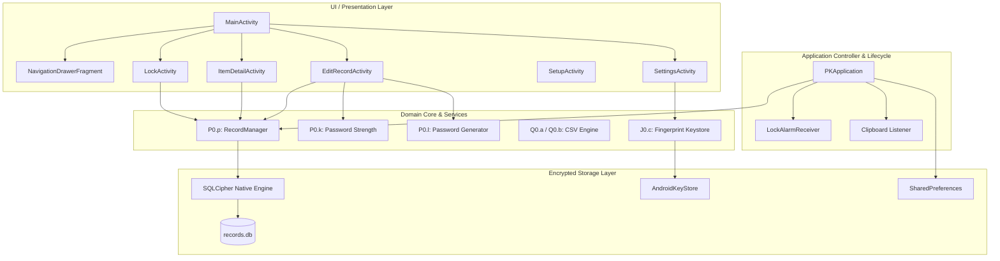
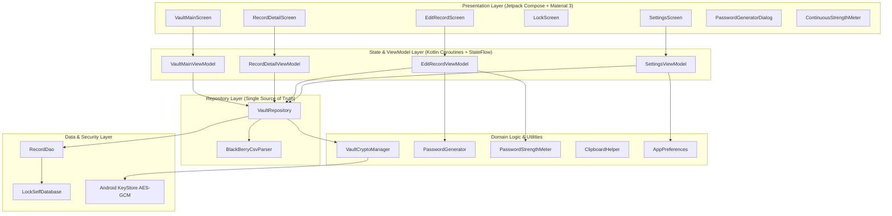

# BlackBerry Password Keeper — Application Architecture Report

## 1. Original BlackBerry Architecture Model

The original BlackBerry Password Keeper (`com.blackberry.passwordkeeper`) employs a traditional Android Activity/Fragment architectural pattern anchored by an Application-level controller:

### Architectural Analysis:
1. **Activity-Centric Orchestration**: Screens are implemented as standalone Activities (`MainActivity`, `ItemDetailActivity`, `EditRecordActivity`, `LockActivity`) backed by legacy `android.app.Fragment` instances. [STATICALLY CONFIRMED]
2. **Centralized Singleton State**: `PKApplication` maintains application-wide session state, monitors foreground/background transitions via `ActivityLifecycleCallbacks`, and controls timeout alarms. [STATICALLY CONFIRMED via `PKApplication.java:580-600`]
3. **Synchronous/Worker Persistence**: `RecordManager` handles raw SQL statements, managing transactions directly on a SQLCipher database handle. [STATICALLY CONFIRMED via `P0/p.java`]

---

## 2. LockSelf Reconstructed Clean Architecture

To eliminate the architectural debt and deprecations of the original application (such as deprecated `android.app.Fragment`, legacy `FingerprintManager`, synchronous disk access on main thread, and embedded AdMob/telemetry SDKs), **LockSelf** implements modern Android Clean Architecture with Jetpack Compose:

---

## 3. Layer Separation Guarantees

| Architecture Layer | Responsibilities in LockSelf | Technologies Used | Security & Privacy Guarantees |
| :--- | :--- | :--- | :--- |
| **Presentation (UI)** | Declarative rendering, screen transitions, responsive drawer, tactile user feedback | Jetpack Compose, Material 3, Navigation Compose | Pure declarative Composables; no direct database or cryptographic access. |
| **ViewModels** | UI state management, coroutine scoping, error state modeling, validation | AndroidX `ViewModel`, `StateFlow`, `asStateFlow()` | Unidirectional data flow (UDF); state preserved across configuration changes. |
| **Repository** | Single source of truth, orchestration between database and cryptographic services | Kotlin Coroutines, `Flow` | In-memory sensitive values zeroed upon vault locking. |
| **Domain Services** | Security scoring, candidate generation, clipboard auto-wipe, preference management | `SecureRandom`, `Normalizer`, `ClipboardManager` | Zero network operations; purely offline algorithmic execution. |
| **Database & DAO** | Encrypted object-relational mapping, versioned migrations, relational integrity | AndroidX Room, SQLite | Foreign keys with `CASCADE` delete; indexed queries; encrypted persistence. |
| **Cryptography** | Master key derivation, authenticated encryption, Keystore biometric wrapping | PBKDF2 with HMAC-SHA256, AES-256-GCM, Android Keystore | Unique 96-bit nonces per encryption; 128-bit authentication tags; hardware-backed keystore. |

---

## 4. Elimination of Legacy Anti-Patterns

1. **Deprecated Fragments**: Replaced deprecated `android.app.Fragment` with type-safe `NavHost` and Composable destinations (`NavRoutes`).
2. **Thread Blocking**: Replaced synchronous SQL queries on the UI thread with asynchronous Room `Flow` and `suspend` functions executing on `Dispatchers.IO`.
3. **Telemetry & Ads**: Stripped all references to `com.google.android.gms.ads` and `com.blackberry.ddt` analytics, ensuring a zero-footprint, 100% offline, privacy-first implementation.
