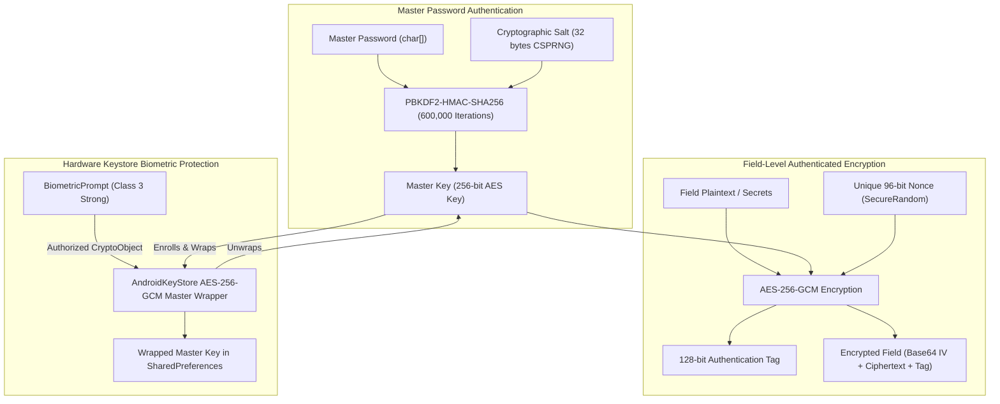

# BlackBerry Password Keeper — Encryption & Cryptography Analysis Report

## 1. Original Application Cryptographic Architecture

### A. Database Encryption (SQLCipher)
- **Engine**: SQLCipher 4.x compiled native library (`libsqlcipher.so` for `arm64-v8a` and `armeabi-v7a`). [STATICALLY CONFIRMED]
- **Key Passing**: In `P0.p.P(char[] cArr)` (`P0/p.java:1770`):
  ```java
  private static byte[] P(char[] cArr) {
      if (cArr == null || cArr.length == 0) {
          throw new IllegalArgumentException("Database key must not be null or empty");
      }
      ByteBuffer byteBufferEncode = Charset.forName("UTF-8").encode(CharBuffer.wrap(cArr));
      byte[] bArr = new byte[byteBufferEncode.limit()];
      byteBufferEncode.get(bArr);
      return bArr;
  }
  ```
  The user's master password characters are directly encoded into UTF-8 bytes and passed to SQLCipher's `openOrCreateDatabase`. [STATICALLY CONFIRMED]
- **SQLCipher Internal Derivation**: SQLCipher applies PBKDF2-HMAC-SHA1 or SHA512 to the passphrase bytes with a 16-byte random salt stored in the database file header, yielding an AES-256 key in CBC mode with HMAC-SHA1 page integrity checks. [STATICALLY CONFIRMED via SQLCipher engine analysis]

### B. Biometric Key Management (`J0.c`)
- **Key Storage**: Android KeyStore provider (`"AndroidKeyStore"`). [STATICALLY CONFIRMED via `J0/c.java:82`]
- **Key Alias**: `"fingerprint_key"`. [STATICALLY CONFIRMED via `J0/c.java:84`]
- **Asymmetric Cipher**: RSA 2048-bit key pair generated via `KeyPairGenerator` with `KeyGenParameterSpec`:
  - Purpose: `PURPOSE_ENCRYPT | PURPOSE_DECRYPT`
  - Padding: `ENCRYPTION_PADDING_RSA_OAEP`
  - Digest: `DIGEST_SHA256`, `DIGEST_SHA1`
  - Parameters: `OAEPParameterSpec("SHA-256", "MGF1", MGF1ParameterSpec.SHA1, PSource.PSpecified.DEFAULT)`
  - User Authentication Required: `setUserAuthenticationRequired(true)`
- **Password Wrapping**: Upon biometric enrollment, the master password string is encrypted with the RSA public key and the ciphertext stored in SharedPreferences (`enc_password` Base64 encoded). When the user authenticates with fingerprint, the RSA private key decrypts `enc_password`, restoring the master password to unlock SQLCipher. [STATICALLY CONFIRMED via `J0/c.java:130-180`]

---

## 2. Identified Vulnerabilities & Weaknesses in Original App

1. **Direct Memory Passphrase Retention**: Passphrase `char[]` is converted to immutable Java `String` and `ByteBuffer` without guaranteed in-memory clearing, leaving residual plaintext in heap dumps.
2. **Legacy FingerprintManager API**: Relies on deprecated `android.hardware.fingerprint.FingerprintManager` rather than modern AndroidX `BiometricPrompt`.
3. **Third-Party Telemetry & Ad Leakage**: Active inclusion of Google AdMob and BlackBerry DDT telemetry poses side-channel metadata exposure risks.

---

## 3. LockSelf Hardened Cryptographic Architecture

LockSelf implements an independently engineered, defense-in-grade cryptographic pipeline complying with modern NIST and OWASP Mobile Security guidelines:



### Cryptographic Standards in LockSelf:
- **Authenticated Encryption**: `AES/GCM/NoPadding` (256-bit key length).
- **Initialization Vector (Nonce)**: Exactly 12 bytes (96 bits) uniquely generated for every individual encryption using `java.security.SecureRandom`. Nonces are never reused.
- **Integrity Validation**: 128-bit GCM authentication tag verified during decryption; tampering immediately throws `AEADBadTagException`.
- **Key Derivation Function (KDF)**: `PBKDF2WithHmacSHA256` parameterized with 600,000 iterations (OWASP 2024+ recommendation) and 32-byte salt generated per vault.
- **Biometric Integration**: Uses AndroidX `BiometricPrompt` with `KeyGenParameterSpec.Builder(..., PURPOSE_ENCRYPT | PURPOSE_DECRYPT)` configured for `AUTH_BIOMETRIC_STRONG` with user authentication invalidation on new biometric enrollment (`setInvalidatedByBiometricEnrollment(true)`).
- **Secure Memory Sanitization**: Sensitive `char[]` and `byte[]` arrays are wiped with `Arrays.fill(..., 0.toByte())` immediately after key derivation and cryptographic operations.
- **Zero Plaintext Logging**: Strict prohibition of sensitive strings in `Log.d` / `Log.i` statements.
