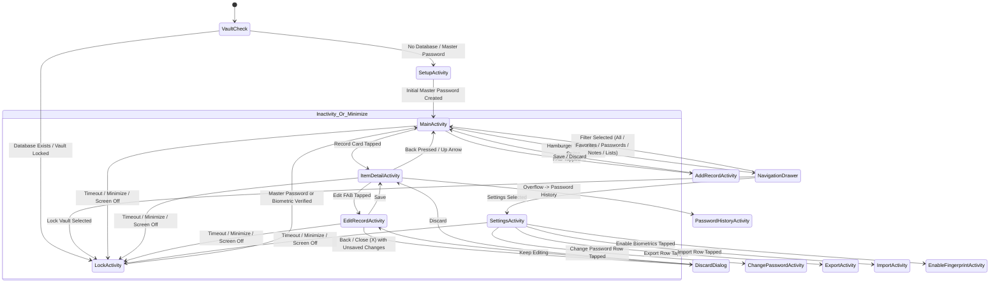

# BlackBerry Password Keeper — Navigation Flow Report

## 1. Primary Navigation State Machine



---

## 2. Navigation Routes & Transition Contracts

| Source Screen | Trigger Action | Destination Screen | Data Passed | Result / Return Contract | Evidence Classification |
| :--- | :--- | :--- | :--- | :--- | :--- |
| `MainActivity` | Tap Record Card | `ItemDetailActivity` | `item_id: String` (record ID), `filter_type` | Returns when user navigates back; list refreshes if record modified. | STATICALLY CONFIRMED |
| `MainActivity` | Tap Floating Action Button | `AddRecordActivity` | `record_type: Int` (0: Password, 1: Note, 2: List) | `RESULT_OK` on record created; triggers list refresh. | STATICALLY CONFIRMED |
| `ItemDetailActivity` | Tap Edit FAB | `EditRecordActivity` | `item_id: String`, `screen_type: 1` | `RESULT_OK` on save; detail screen refreshes. | STATICALLY CONFIRMED |
| `ItemDetailActivity` | Menu $\to$ Password History | `PasswordHistoryActivity` | `item_id: String` | Read-only inspection; returns on Up arrow. | STATICALLY CONFIRMED |
| `SettingsActivity` | Tap Change Password | `ChangePasswordActivity` | None | Re-encrypts database and returns to settings. | STATICALLY CONFIRMED |
| `SettingsActivity` | Tap Export | `ExportActivity` | None | File picker result; returns success toast. | STATICALLY CONFIRMED |
| `SettingsActivity` | Tap Import | `ImportActivity` | None | Returns count of imported/merged records. | STATICALLY CONFIRMED |

---

## 3. Back-Press & Discard Confirmation Invariant

In `EditRecordActivity.java:g0()`:
```java
private void g0() {
    a aVar = (a) getFragmentManager().findFragmentByTag("edit_fragment");
    if (!(aVar != null ? aVar.r() : true)) {
        setResult(0);
        finish();
    } else {
        AlertDialog.Builder builder = new AlertDialog.Builder(this);
        builder.setMessage(R.string.changes_made_message)
               .setPositiveButton(R.string.discard_button, new b())
               .setNegativeButton(R.string.keep_editing_button, new a());
        builder.create().show();
    }
}
```
[STATICALLY CONFIRMED via `EditRecordActivity.java:45-56`]

If the user has modified any field, pressing Android Back or the toolbar Clear (X) icon **must not** abruptly destroy edits. An alert dialog prompts the user with "Discard" or "Keep editing".
LockSelf replicates this safety check in `EditRecordScreen.kt`.
