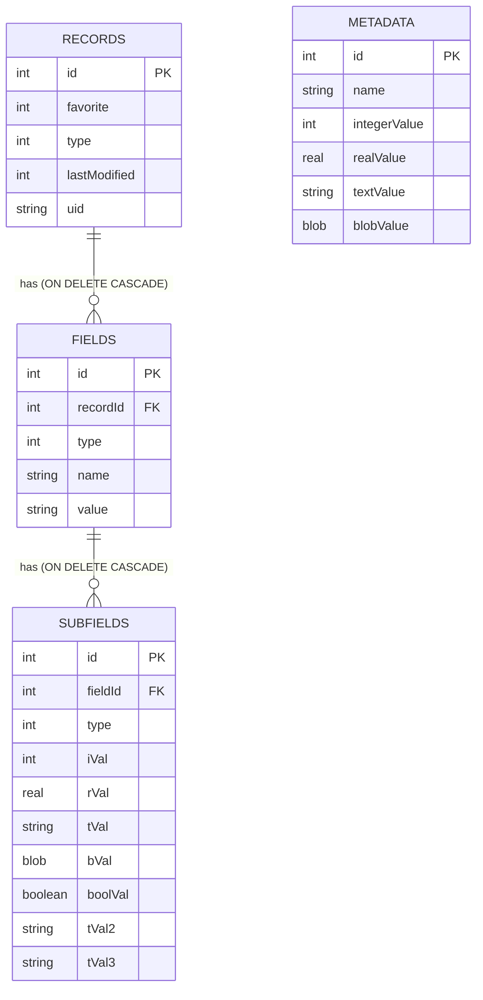

# Legacy Password Keeper — Database Schema Report

## 1. Decompiled Original Schema (SQLCipher)

The database schema definition was extracted directly from `P0.p.D0(SQLiteDatabase)` (`P0/p.java:1298-1301`) and migration method `P0.p.F0(int)`:

```sql
-- Records Table
CREATE TABLE IF NOT EXISTS records (
    id INTEGER PRIMARY KEY AUTOINCREMENT,
    favorite INTEGER NOT NULL,
    type INTEGER NOT NULL,
    lastModified INTEGER NOT NULL,
    uid TEXT NOT NULL
);

-- Fields Table
CREATE TABLE IF NOT EXISTS fields (
    id INTEGER PRIMARY KEY AUTOINCREMENT,
    recordId INTEGER NOT NULL,
    type INTEGER NOT NULL,
    name TEXT,
    value TEXT,
    FOREIGN KEY (recordId) REFERENCES records(id) ON DELETE CASCADE
);

-- Subfields Table
CREATE TABLE IF NOT EXISTS subfields (
    id INTEGER PRIMARY KEY AUTOINCREMENT,
    fieldId INTEGER NOT NULL,
    type INTEGER NOT NULL,
    iVal INTEGER,
    rVal REAL,
    tVal TEXT,
    bVal BLOB,
    boolVal BOOLEAN,
    tVal2 TEXT,
    tVal3 TEXT,
    FOREIGN KEY (fieldId) REFERENCES fields(id) ON DELETE CASCADE
);

-- Metadata Table
CREATE TABLE IF NOT EXISTS metadata (
    id INTEGER PRIMARY KEY AUTOINCREMENT,
    name TEXT NOT NULL,
    integerValue INTEGER,
    realValue REAL,
    textValue TEXT,
    blobValue BLOB
);
```

### Initial Metadata Records (`P0.p:1303-1314`):
- `db_schema_version`: `7` (Integer) [STATICALLY CONFIRMED]
- `db_creation_time`: Current timestamp in seconds (Integer) [STATICALLY CONFIRMED]
- `password_last_changed_time`: Current timestamp in seconds (Integer) [STATICALLY CONFIRMED]

---

## 2. Schema Evolution & Migration History

Extracted from `P0.p.F0(int i5)` (`P0/p.java:1320-1365`):

| Schema Version | Migration Operation | Architectural Rationale | Evidence Classification |
| :--- | :--- | :--- | :--- |
| **Version 1** | Initial creation of `subfields` with `(id, fieldId, type, iVal, rVal, tVal, bVal)` | Introduction of flexible subfield attributes | STATICALLY CONFIRMED |
| **Version 2 & 3** | Internal structure updates and index verifications | Transactional stability | STATICALLY CONFIRMED |
| **Version 4** | `ALTER TABLE subfields ADD boolVal BOOLEAN` | Added support for checklist checked/unchecked states (`ListCheckBoxSubfield`) | STATICALLY CONFIRMED |
| **Version 5** | `ALTER TABLE subfields ADD tVal2 TEXT; ALTER TABLE subfields ADD tVal3 TEXT` | Added support for multi-part custom attributes | STATICALLY CONFIRMED |
| **Version 6** | Query and migrate `TRUSTED_APPLICATIONS` metadata fields | Autofill and App association handling | STATICALLY CONFIRMED |
| **Version 7** | Finalized metadata tracking for backup synchronization tokens | Cloud backup V2 support | STATICALLY CONFIRMED |

---

## 3. Entity-Relationship Model



---

## 4. Subfield Column Utilization by Type

| Subfield Class | Enum Identifier | Column `tVal` | Column `boolVal` | Column `iVal` | Evidence Classification |
| :--- | :--- | :--- | :--- | :--- | :--- |
| `HistoricalPasswordSubfield` (`P0.f`) | `HISTORICAL_PASSWORD` (`6`) | Password String | `NULL` | Changed timestamp (seconds) | STATICALLY CONFIRMED |
| `ListCheckBoxSubfield` (`P0.g`) | `LIST_CHECK_BOX` (`12`) | Checklist Item Text | `true`/`false` | Item Order Index (0, 1, 2...) | STATICALLY CONFIRMED |
| `PasswordSetTimeSubfield` (`P0.i`) | `PASSWORD_SET_TIME` (`9`) | `NULL` | `NULL` | Set timestamp (seconds) | STATICALLY CONFIRMED |

---

## 5. LockSelf Modern Database Architecture (Room SQLite)

In LockSelf, this logical schema is faithfully implemented using AndroidX Room with clean entity classes and DAOs:

### Entities:
1. **`RecordEntity`**:
   - `id: Long` (Primary Key, AutoGenerate)
   - `title: String`
   - `type: RecordType` (`PASSWORD`, `NOTE`, `LIST`)
   - `isFavorite: Boolean`
   - `lastModified: Long` (epoch timestamp)
   - `uid: String` (UUID)
   - `tags: String` (Comma-delimited string of assigned tags)
2. **`RecordFieldEntity`**:
   - `id: Long` (Primary Key, AutoGenerate)
   - `recordId: Long` (Foreign Key referencing `RecordEntity(id)` with `CASCADE` delete, Indexed)
   - `fieldType: FieldType` (`USERNAME`, `PASSWORD`, `WEBSITE`, `NOTE`, `CUSTOM`)
   - `fieldName: String?`
   - `encryptedValue: String` (AES-256-GCM ciphertext)
3. **`ChecklistItemEntity`**:
   - `id: Long` (Primary Key, AutoGenerate)
   - `recordId: Long` (Foreign Key referencing `RecordEntity(id)` with `CASCADE` delete, Indexed)
   - `text: String`
   - `isChecked: Boolean`
   - `sortOrder: Int`
4. **`PasswordHistoryEntity`**:
   - `id: Long` (Primary Key, AutoGenerate)
   - `recordId: Long` (Foreign Key referencing `RecordEntity(id)` with `CASCADE` delete, Indexed)
   - `encryptedPassword: String` (AES-256-GCM ciphertext)
   - `changedAt: Long` (timestamp)

### Relational Integrity:
- All child tables enforce `ForeignKey.CASCADE` on `recordId`, guaranteeing that deleting a record atomically deletes all associated fields, checklist items, and password history entries with zero orphan rows.
