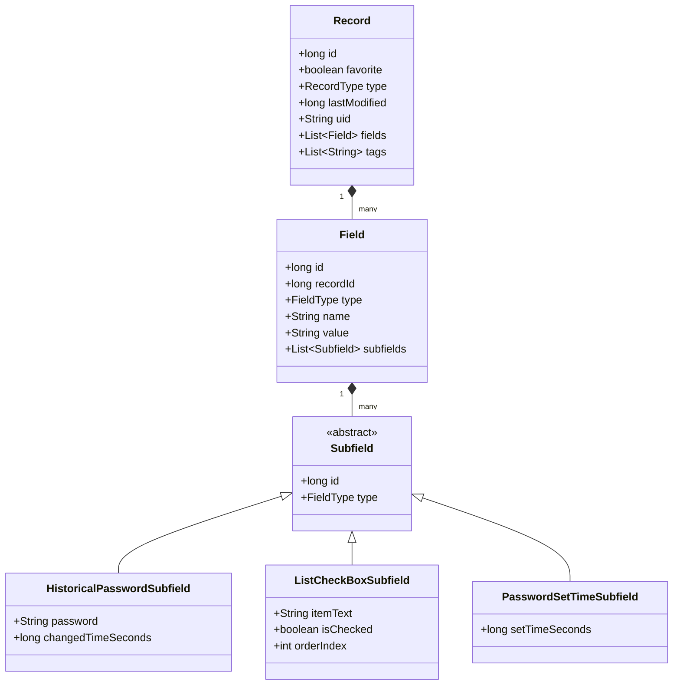

# Legacy Password Keeper — Record Model Analysis Report

## 1. Domain Record Hierarchy

Legacy Password Keeper structures all user items under a unified `Record` polymorphic container (`P0.m`), differentiated by `RecordType` (`P0.q`).



---

## 2. Record Types & Field Compositions

### A. Password Record (`RecordType.PASSWORD`)
- **Primary Visual Identification**: CrimsonRed accent strip (`#D12B58`). [STATICALLY CONFIRMED via `colors.xml`]
- **Mandatory Fields**:
  - `TITLE`: Record display title.
- **Standard Predefined Fields**:
  - `USERNAME`: Account identifier / email address.
  - `PASSWORD`: Current account secret.
  - `WEBSITE`: Web URL or domain name.
  - `NOTE`: Multiline notes specific to the credential.
- **Attached Subfields**:
  - `PASSWORD_SET_TIME` (`PasswordSetTimeSubfield`): Set on initial save or when password changes.
  - `HISTORICAL_PASSWORD` (`HistoricalPasswordSubfield`): Created automatically whenever the user updates the `PASSWORD` field; retains the old password and timestamp.
  - `CUSTOM`: Optional custom labeled string fields.
  - `SECURITY_QUESTION`: Question/Answer pairs.

### B. Note Record (`RecordType.NOTE`)
- **Primary Visual Identification**: Cyan accent strip (`#00B0D4`). [STATICALLY CONFIRMED via `colors.xml`]
- **Fields**:
  - `TITLE`: Note heading.
  - `NOTE`: Multiline plain text body.
  - No username, password, or URL fields rendered.

### C. List / Checklist Record (`RecordType.LIST`)
- **Primary Visual Identification**: EmeraldGreen accent strip (`#46A66C`). [STATICALLY CONFIRMED via `colors.xml`]
- **Fields**:
  - `TITLE`: Checklist title.
  - `LIST`: Container field holding multiple `ListCheckBoxSubfield` items.
- **Checklist Item Model (`ListCheckBoxSubfield`)**:
  - `itemText` (`tVal`): Display label of task/item.
  - `isChecked` (`boolVal`): Completion state.
  - `orderIndex` (`iVal`): Zero-based sequential ordering index.

---

## 3. Specialized Subfield Specifications

| Specialized Subfield | Class in APK | Database Columns Used | Triggers & Invariant Behaviors | Evidence Classification |
| :--- | :--- | :--- | :--- | :--- |
| `HistoricalPasswordSubfield` | `P0.f` | `tVal` (String), `iVal` (Long) | Created when `Field(PASSWORD)` is edited with a new value. Never exposed directly in list view; only rendered on demand in `PasswordHistoryActivity` with unmask toggles. | STATICALLY CONFIRMED |
| `ListCheckBoxSubfield` | `P0.g` | `tVal` (String), `boolVal` (Boolean), `iVal` (Integer) | Represents discrete items. Toggling checkbox updates `boolVal` in database. Reordering updates `iVal`. | STATICALLY CONFIRMED |
| `PasswordSetTimeSubfield` | `P0.i` | `iVal` (Long) | Stored as UNIX epoch timestamp in seconds. Used by settings screen to display "Password last changed" info. | STATICALLY CONFIRMED |

---

## 4. Subtitle Prioritization Logic

In `MainActivity` and record list views, the original app computes card subtitles with a strict fallback chain to prevent empty or awkward UI placeholders:

```
if (hasUsername && hasWebsite) -> "username • website"
else if (hasUsername) -> "username"
else if (hasWebsite) -> "website"
else if (hasPassword) -> "••••••••"
else -> "" (empty, title only)
```
[STATICALLY CONFIRMED via `I0/m.java` and `MainActivity.java`]

LockSelf faithfully implements this exact subtitle prioritization rule in `VaultMainScreen.kt`.
